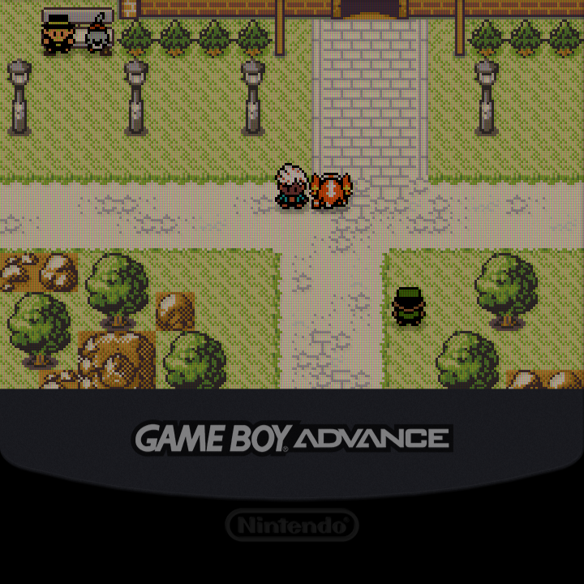
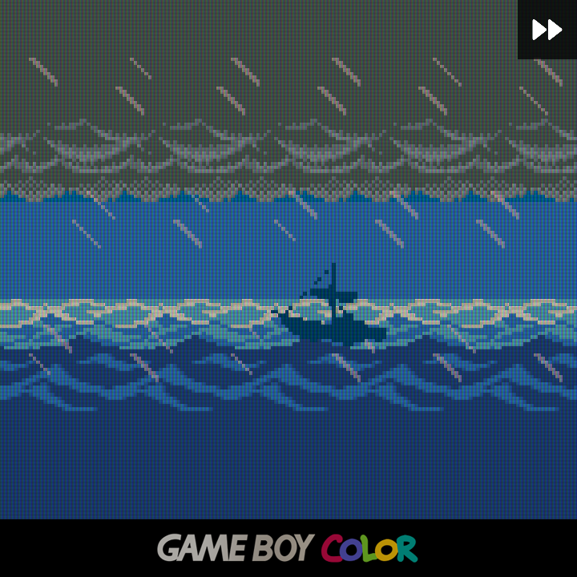
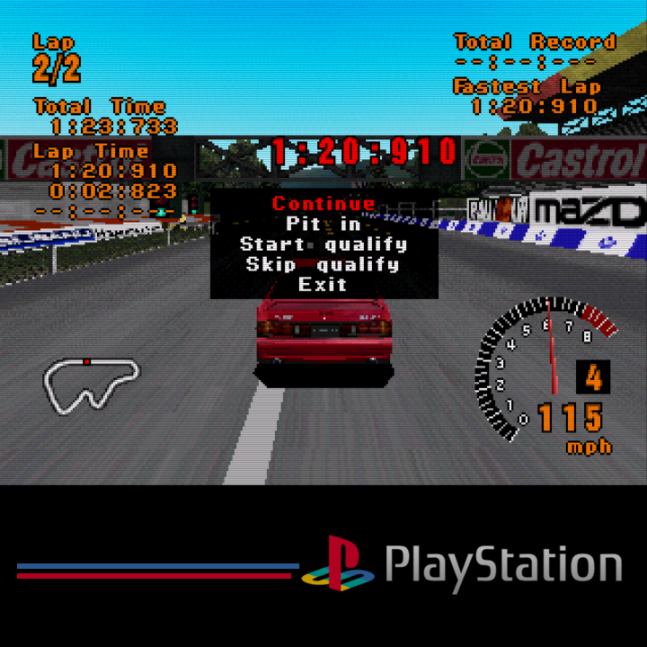
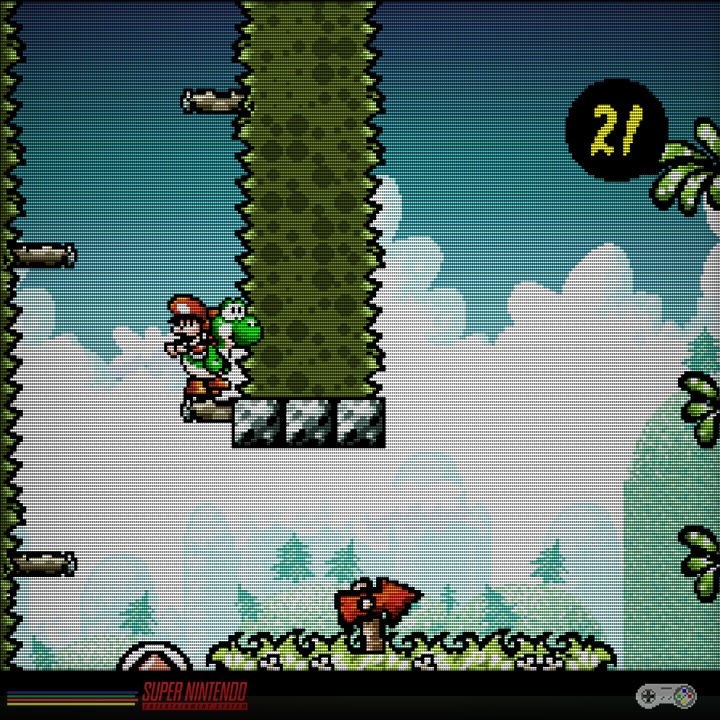

# Overlays I use:

- Odin 3: [Watomsk's Overlays](https://github.com/Watomsk/Overlays)
- Brick: [KrutzOtrem's Overlays](https://github.com/KrutzOtrem/Trimui-Brick-Overlays?tab=readme-ov-file)
- CubeXX: Combination of [BB64](https://community.muos.dev/t/bb64s-720x720-handheld-bezel-pack-gb-gbc-gba-ngpc-gg-vb-for-rg-cubexx/65) and the custom top-aligned overlays below.

# Custom Top-Aligned Overlays for 720x720 screens

For any platforms that aren't square, I prefer having the game pushed to the top of my screen because it's visually closer to the controls and better for ergos. I wasn't able to find any overlays that accomplished this and also had no grids or scanlines included (I prefer to use shaders to get those) so I made my own. Some of them have shadow and no-shadow options; some just have the shadows. For all platforms, the overlays *do not need an offset*, but the *viewports do*.

Credits to [Watomsk](https://github.com/Watomsk/Overlays) for the iconography. All my custom overlays use the icons from his 1080p set, just realigned.

Tested on Anbernic RG CubeXX on Retroarch and MuOS Pickles. I don't think this will work on any Minarch/MinUI/NextUI because you can't offset the viewport.

## GBA
Use with integer scaling and your choice of the BB64 GBA overlays (included).

This config is just retroarch settings on top of the already excellent 720x720 GBA overlays made by BB64.

#### Quick Menu -> On-Screen Overlay

| Setting | Value | Notes |
|---------|-------|-------|
| Overlay Preset | GBA | Your choice of BB64 GBA Overlays |
| (Portrait) Overlay Y Offset | 0.065 | The top of the overlay will be off screen, but the game itself will be top-aligned. |

#### Settings -> Video -> Scaling

| Setting | Value | Notes |
|---------|-------|-------|
| Integer Scale | ON | |
| Viewport Anchor Bias X | 0.5 | Setting doesn't matter |
| Viewport Anchor Bias Y | 0.0 | Required to align to top | 

## GBC 
Use with **non-integer scaling**.

#### Settings -> Video -> Scaling

| Setting | Value | Notes |
|---------|-------|-------|
| Integer Scale | OFF | |
| Viewport Anchor Bias X | 0.5 | Setting doesn't matter |
| Viewport Anchor Bias Y | 0.0 | Required to align to top |

## 4:3 (PSX, Dreamcast etc.)
Use with **non-integer scaling**.

#### Settings -> Video -> Scaling

| Setting | Value | Notes |
|---------|-------|-------|
| Integer Scale | OFF | |
| Viewport Anchor Bias X | 0.5 | Setting doesn't matter |
| Viewport Anchor Bias Y | 0.0 | Required to align to top |

## SNES (~8:7, but not quite.)
SNES is more involved due to the 1:1 PAR resolution of 256x239 but it will work with a 3x integer scale. This is really 256x224 + a top/bottom overscan, meaning a 3x integer scale will disply at 768x672, NOT 768x717 as Retroarch claims in the settings below. The overlays are sized to 720x672 so that the values below work.

If you want non-integer scaling, `SNES_top_noninteger` will work.

### Integer Overscaled
This is similar to the 3x integer overscale method talked about by RetroGameCorps in his review of the CubeXX. For some reason, Retroarch's viewport anchor bias settings didn't behave the way they should (?) and you need to set up a custom resolution and offest to work properly.

| Setting | Value | Notes |
|---------|-------|-------|
| Aspect Ratio | Custom | These correspond to 1:1 PAR (256x239) |
| Custom Aspect Ratio (X Position) | 0 | |
| Custom Aspect Ratio (Y Position) | -24 | |
| Custom Aspect Ratio (Width) | 768 (3x) | Use the DPAD to select the multipliers |
| Custom Aspect Ratio (Height) | 717 (3x) | Use the DPAD to select the multipliers |
| Crop Overscan | OFF | This makes sure that the spare vertical pixels >224 get ignored for scaling calculations.

The rest of the settings have no effect. 

#### Note for Pickles
I use MuOS and Pickles changes the way you do this. It's simpler in some ways and confusing/misleading in others. This is what you need:

| Setting | Value | Notes |
|---------|-------|-------|
| Video/Aspect Ratio | Pixel Perfect | Pickles equivalent of 1:1 PAR |
| Video/Scale Multiplier | 3x | We are doing a 3x integer scale |
| Video/Scaling Mode | Full Height | Integer **WILL NOT** work properly here. I don't know why it lies, but setting the aspect ratio + scale + `integer` here fits to the screen width so you get non-integer scaling. |
| Dislpay/Adjustment/Y Offset | -24 | Same as before. |

## NES (8:7)
This one is 8:7 for real. Non-integer scaled only. 

Integer overscale cuts off too much here imo, but it *could* do 768x720 to fill the screen entirely. Set `Integer Scale Axis` to `X` and `Overscale` for that. I recommend a Sharp Shimmerless Shader + light CRT shader if you'd like.

### Non-integer scaled
Use `NES_top.cfg`. 

#### Settings -> Video -> Scaling

| Setting | Value | Notes |
|---------|-------|-------|
| Integer Scale | OFF | |
| Viewport Anchor Bias X | 0.5 | Setting doesn't matter |
| Viewport Anchor Bias Y | 0.0 | Required to align to top |

